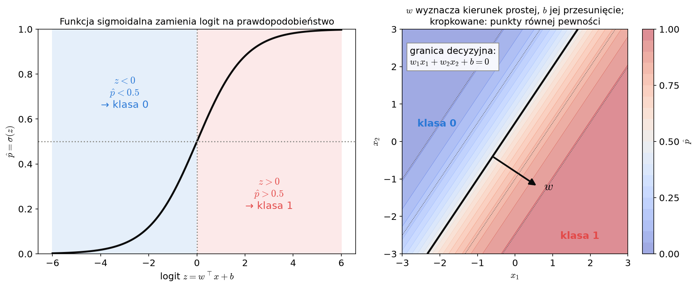
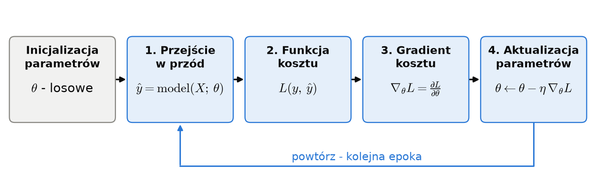
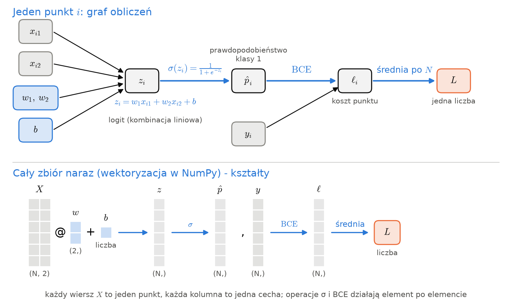

# Notatki: Część I - regresja logistyczna w NumPy

Pełne wersje tekstów z `lab_3_solution.ipynb` (stan na 2026-10-25, przed skróceniem).
Materiał prywatny prowadzącego - nie udostępniać studentom.

<!-- lab_3_solution.ipynb, komórka [1] -->

## Wstęp

Na tym laboratorium poznamy podstawy sieci neuronowych i uczenia głębokiego (*deep learning*). Najpierw
zaimplementujemy od zera w NumPy regresję logistyczną i jej trening spadkiem wzdłuż gradientu z propagacją wsteczną.
Następnie przeniesiemy to samo do frameworka PyTorch (tensory, autograd, `nn.Module`, optymalizatory), a na koniec
zbudujemy sieć MLP, która poradzi sobie z danymi nieseparowalnymi liniowo.

---

<!-- lab_3_solution.ipynb, komórka [3] -->

---

Jak już wiemy, model w uczeniu maszynowym to algorytm, który ma w jakimś stopniu modelować rzeczywistość.

Modele parametryczne są funkcjami, których argumentami są wejście $x$ oraz zestaw parametrów $\theta$. Parametrami mogą być:
- współczynniki $\alpha$ i $\beta$ w regresji liniowej
- wagi sieci neuronowej
- wagi $w$ i wyraz wolny $b$ w regresji logistycznej

W literaturze modele z parametrami oznacza się jako funkcje $f(x, \theta)$ lub $f(x; \theta)$.

Dla danych $X$ oraz zestawu parametrów $\theta$ model zwraca predykcje:

$$
\hat y = f(X; \theta)
$$

Dotychczas zarówno do definicji modelu i jak doboru parametrów na dotychczasowych laboratoriach wykorzystywaliśmy wysokopoziomowe interfejsy scikit-learn. Na tym laboratorium, przyjrzymy się w jaki sposób sieci neuronowe oraz inne modele parametryczne mogą zostać zaimplementowane z wykorzystaniem bardziej niskopoziomowego API.

---

W przypadku sieci neuronowych metodą optymalizacji będzie Gradient Descent - spadek wzdłóż gradientu.

Idea jest następująca: definiujemy **funkcję kosztu (cost function)**, nazywaną też funkcją straty (*loss function*),
czyli liczbę $L$ mierzącą, jak bardzo predykcje $\hat y$ różnią się od prawdziwych etykiet $y$. **Uczeniem** parametrów w przypadku tej metody będzie **szukanie parametrów, dla których koszt jest najmniejszy.**

---

<!-- lab_3_solution.ipynb, komórka [4] -->

---
## Regersja Logistyczna z użyciem propagacji wstecznej w NumPy

Aby nabyć intuicję dotyczącą tego, w jaki sposób działa propagacja wsteczna i później sieci neuronowe, rozpoczniemy od implementacji regresji logistycznej w bibliotece NumPy.

Jako zbiór danych mamy punkty na płaszczyźnie, opisane cechami $x = (x_1, x_2)$, z dwóch klas ($y \in \{0, 1\}$). W naszym przypadku klasy da się
idealnie rozdzielić prostą (są **liniowo separowalne**). 

Do stworzenia modelu przypisującego klasy każdemu z naszych punktów użyjemy **regresji logistycznej** (laboratorium 2):
$$
\hat p = \sigma(w^\top x + b) = \frac{1}{1 + e^{-(w^\top x + b)}}
$$

Do treningu naszego modelu używającego regresji logistycznej, użyjemy zaimplementowanego przez **algorytmu propagacji wstecznej (Backpropagation)**. Składa się on z czterech osobnych kroków, które zaimplementujemy po kolei:

1. **Przejście w przód (forward pass)** - liczymy predykcje $\hat p$ dla aktualnych parametrów $\theta$ (Zadanie 2).
   Na początku parametry to małe, losowe wartości.
2. **Obliczenie funkcji kosztu** - mierzymy błąd predykcji $L$ (Zadanie 3).
3. **Przejście wstecz (backward pass)** - liczymy gradient $\nabla_\theta L$, czyli wektor pochodnych kosztu po
   każdym z parametrów; wskazuje on kierunek, w którym koszt najszybciej **rośnie** (Zadanie 4).
4. **Aktualizacja parametrów** - optymalizator (u nas spadek wzdłuż gradientu) robi mały krok w stronę przeciwną
   do gradientu, gdzie $\eta$ to **stała ucząca (learning rate)** (Zadanie 5):

   $$
   \theta \leftarrow \theta - \eta \, \nabla_\theta L
   $$

Mówiac o propagacji wstecznej, zwykle mamy na myśli cały cykl, który powtarzamy dla każdej paczki
danych (batch),ale Ściśle ujmując, **propagacja wsteczna (backpropagation)** to tylko algorytm z kroku 3: sposób liczenia gradientu
regułą łańcuchową. Backward pass to jedno wykonanie tego algorytmu dla paczki
danych.

Poniżej definiujemy funckje pomocnicze rysujące zbiór danych (`plot_dataset`), granicę decyzyjną modelu (`plot_decision_boundary`) oraz
wynik treningu (`plot_training`). Model przekazujemy do nich jako funkcję `predict_proba`, więc zadziałają zarówno
dla modeli w NumPy, jak i tych, które zdefiniujemy później PyTorchu.

---

<!-- lab_3_solution.ipynb, komórka [7] -->

#### Definiowanie pochodnej

Przed przystąpieniem do traningu modelu, stworzymy funkcje pomocnicze do obliczania pochodnych, które później pomogą nam w wyznaczaniu gradientu.

[Pochodna](https://en.wikipedia.org/wiki/Derivative) $f'(x)$ to nachylenie stycznej do wykresu funkcji w punkcie $x$
([animacja: Wikimedia Commons](https://commons.wikimedia.org/wiki/File:Tangent_function_animation.gif)):

Można ją policzyć **analitycznie** zgodnie z definicją:

$$
f'(x) = \lim_{h \to 0} \frac{f(x+h) - f(x)}{h}
$$

albo
[**numerycznie**](https://en.wikipedia.org/wiki/Numerical_differentiation) - przesuwając $x$ o małe $h$ i mierząc
zmianę wartości funkcji. Użyjemy **różnicy centralnej (central difference)**:
$$
f'(x) \approx \frac{f(x+h) - f(x-h)}{2h}
$$

#### Zadanie 1 (0.5 punktu)

Uzupełnij:
- `analytical_df(x)` - pochodna funkcji $f(x) = 3x^2 - 4x + 5$ wyprowadzona na kartce,
- `df(func, x, h)` - pochodna numeryczna **dowolnej** funkcji `func` w punkcie `x`.

Obie funkcje mają działać także dla tablic NumPy (element po elemencie).

---

<!-- lab_3_solution.ipynb, komórka [11] -->

Porównajmy pochodne analityczne (linia) i numeryczne (punkty) dla $f$ oraz dla funkcji z animacji:

$$
g(x) = x \sin(x^2) + 1
$$

której pochodna to:

$$
g'(x) = \sin(x^2) + 2x^2 \cos(x^2)
$$

---

<!-- lab_3_solution.ipynb, komórka [13] -->

Zauważmy, że pochodna numeryczna wymaga tylko możliwości policzenia funkcji, ale dla modelu z $P$ parametrami gradient kosztuje
$2P$ obliczeń kosztu. Dlatego w praktyce, tam gdzie to możliwe, używa się pochodnych analitycznych. Pochodne numeryczne służą głównie do
ich **sprawdzania** (*gradient checking*) - my będziemy używać ich dla naszej wygody.

---

<!-- lab_3_solution.ipynb, komórka [14] -->

#### Definicja modelu i forward pass

Zdefiniujemy teraz nasz model jako klasę `LogisticRegression`. Obiekt tej klasy przechowuje parametry modelu
(`self.w`, `self.b`) i potrafi policzyć predykcje, czyli wykonać **forward pass** (metoda `forward`).
Z bardzo podobnymi klasami spotkamy się później w PyTorchu - tam również model to klasa z parametrami
i metodą `forward`.

Przypomnijmy wzory. Dla punktu $x$ model liczy najpierw logit, czyli kombinację liniową cech:

$$
z = w^\top x + b = w_1 x_1 + w_2 x_2 + b
$$

Dla wszystkich $N$ punktów naraz (wiersze macierzy $X$) to samo zapisujemy wektorowo:

$$
z = X w + b
$$

Później model przepuszcza logit przez funkcję sigmoidalną $\sigma$ i wyznacza prawdopodobieństwo $\hat p$:

$$
\sigma(z) = \frac{1}{1 + e^{-z}}
$$

$$
\hat p = \sigma(z)
$$

#### Zadanie 2 (1 punkt):

Uzupełnij:
- `sigmoid(z)` - element po elemencie,
- `LogisticRegression.__init__` - `self.w`: wektor `(n_features,)` z rozkładu normalnego o odchyleniu 0.1
  (`rng.normal`), `self.b`: `0.0`,
- `LogisticRegression.forward` - prawdopodobieństwa klasy 1 dla wszystkich punktów `X` naraz, kształt `(N,)`
  (`X @ w + b` ma kształt $(N, 2) \cdot (2,) \to (N,)$, a `np.exp` działa element po elemencie).

---

<!-- lab_3_solution.ipynb, komórka [19] -->

### Zadanie 3: Funkcja kosztu

Jako funkcji kosztu użyjemy **binarnej entropii krzyżowej (binary cross-entropy, BCE)**, zdefiniowanej w laboratorium 2:
$$
L = BCE(y, \hat{p}) = -\frac{1}{N} \sum_{i=1}^N \left[ y_i \log(\hat{p}_i) + (1 - y_i) \log(1 - \hat{p}_i) \right]
$$

Koszt pojedynczego punktu, czyli wyraz sumy wraz z minusem, będziemy dalej oznaczać $\ell_i$. Cały graf obliczeń -
od danych i parametrów do kosztu:

Uzupełnij `bce` - średni koszt wszystkich punktów (jedna liczba).
`np.clip` w szablonie chroni przed `log(0)`.

---

<!-- lab_3_solution.ipynb, komórka [22] -->

Na wykresach poniżej widać koszt punktu oraz jego pochodną po logicie $z$ (liczoną Twoją funkcją `df`)
w porównaniu z MSE.
Gdy model bardzo się myli, pochodna BCE wynosi około $-1$ (silny sygnał do poprawy), a pochodna MSE jest prawie
zerowa - dlatego do klasyfikacji używamy entropii krzyżowej.

---

<!-- lab_3_solution.ipynb, komórka [24] -->

### Gradient i propagacja wsteczna

**Gradient** to wektor pochodnych cząstkowych kosztu po każdym z parametrów - u nas
$\nabla_\theta L = \left[ \frac{\partial L}{\partial w_1}, \frac{\partial L}{\partial w_2}, \frac{\partial L}{\partial b} \right]$.
Wskazuje kierunek, w którym koszt najszybciej **rośnie**, więc parametry przesuwamy w stronę przeciwną,
o krok skalowany stałą uczącą $\eta$ (Zadanie 5):

$$
\theta \leftarrow \theta - \eta \, \nabla_\theta L
$$

<!-- TODO: zastąpić gifem -->

Koszt to złożenie prostych funkcji: $z_i = w^\top x_i + b$, $\hat p_i = \sigma(z_i)$,
$\ell_i(y_i, \hat p_i)$. Z **reguły łańcuchowej (chain rule)** pochodna po parametrze to iloczyn pochodnych lokalnych
kolejnych ogniw:

$$
\frac{\partial \ell_i}{\partial w_j} =
\underbrace{\frac{\partial \ell_i}{\partial \hat p_i}}_{\text{BCE}} \cdot
\underbrace{\frac{\partial \hat p_i}{\partial z_i}}_{\text{sigmoida}} \cdot
\underbrace{\frac{\partial z_i}{\partial w_j}}_{x_{ij}}
$$

**Propagacja wsteczna** liczy te iloczyny od końca grafu, dzięki czemu wspólną część łańcucha liczymy raz dla wszystkich
parametrów. Koszt batcha (u nas całego zbioru treningowego) to średnia $L = \frac{1}{N} \sum_{i=1}^{N} \ell_i$, a każdy
parametr wpływa na niego przez wszystkie punkty. Najpierw liczymy więc dla każdego punktu, jak koszt zależy od jego logitu:

$$
\delta_i = \frac{\partial L}{\partial z_i} = \frac{1}{N} \cdot \frac{\partial \ell_i}{\partial \hat p_i} \cdot \frac{\partial \hat p_i}{\partial z_i}
$$

a potem dokładamy ostatnie ogniwo ($\frac{\partial z_i}{\partial w_j} = x_{ij}$, $\frac{\partial z_i}{\partial b} = 1$)
i sumujemy wkłady punktów:

$$
\frac{\partial L}{\partial w_j} = \sum_{i=1}^{N} \delta_i \, x_{ij}
\qquad
\frac{\partial L}{\partial b} = \sum_{i=1}^{N} \delta_i
$$

---

<!-- lab_3_solution.ipynb, komórka [25] -->

#### Zadanie 4 (1 punkt):

Uzupełnij `backward` - funkcja tylko zwraca gradient `(grad_w, grad_b)`, a parametry zmienimy w pętli uczącej
(Zadanie 5). Gradient ma zawsze kształt parametru: `grad_w` - `(2,)`, `grad_b` - liczba. Kroki w szablonie to kolejne
ogniwa łańcucha:

1. `dloss_dp` - pochodna BCE, podana analitycznie:
   $\dfrac{\partial \ell_i}{\partial \hat p_i} = \dfrac{\hat p_i - y_i}{\hat p_i (1 - \hat p_i)}$
   (`df(lambda p: bce(y, p), p_hat)` nie zadziała, bo `bce` zwraca średnią, a nie koszt każdego punktu),
2. `dp_dz` - pochodna sigmoidy, policzona numerycznie funkcją `df` z Zadania 1,
3. `delta` - wszystkie $\delta_i$ naraz, jako wektor o kształcie `(N,)` (bez pętli po punktach),
4. `grad_w` - sumę po punktach dla wszystkich wag naraz daje `X.T @ delta`,
5. `grad_b` - suma `delta`.

Sprawdzarka porówna wynik z gradientem policzonym „na siłę” (przesuwanie parametrów o $\pm h$) i ze wzorem
analitycznym, który wychodzi po policzeniu obu pochodnych lokalnych na kartce:

$$
\frac{\partial L}{\partial w} = \frac{1}{N} X^\top (\hat p - y)
$$

Przykład ręcznie napisanego przejścia w przód i wstecz w NumPy:
[Learning PyTorch with Examples - Warm-up: numpy](https://docs.pytorch.org/tutorials/beginner/pytorch_with_examples.html#warm-up-numpy).

---

<!-- lab_3_solution.ipynb, komórka [28] -->

### Zadanie 5: Pętla ucząca

Mając już wszystkie potrzebne elementy, możemy teraz zaimplementować **pętlę uczącą (training loop)**, czyli iteracyjne optymalizowanie parametrów korzystające, w naszym przypadku, z Gradient Descent.

Zmieniaj parametry w miejscu (przypisz nowe wartości do `model.w` i `model.b`), a do historii dopisuj koszt policzony **przed** aktualizacją, jako liczbę (`float(...)`).
Po sprawdzeniu wytrenujemy model, a `plot_training` narysuje krzywą uczenia z Twojej historii i granicę decyzyjną.
Podobną pętlę w NumPy znajdziesz w tutorialu [Learning PyTorch with Examples - Warm-up: numpy](https://docs.pytorch.org/tutorials/beginner/pytorch_with_examples.html#warm-up-numpy).

---

<!-- lab_3_solution.ipynb, komórka [32] -->

Wypróbuj inne wartości `lr` (np. `0.01`, `5`, `50`) i liczby epok - jak zmienia się krzywa uczenia?

---
