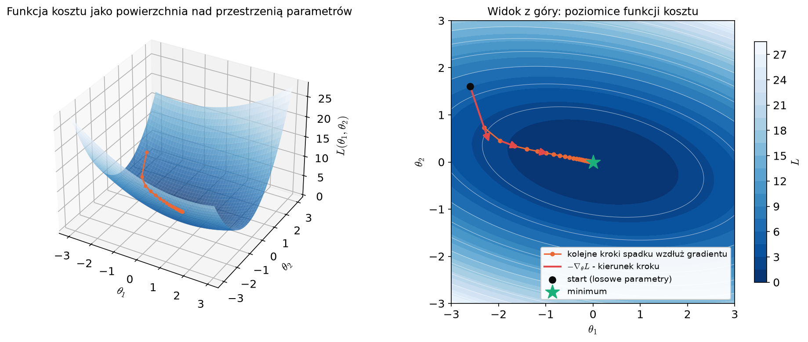

# Notatki: gradient, reguła łańcuchowa i propagacja wsteczna

Uzupełnienie do laboratorium 3 ([lab_3.ipynb](../lab_3.ipynb)), część I.

## Gradient i reguła łańcuchowa

Chcemy, żeby koszt $L$ był jak najmniejszy. Spadek wzdłuż gradientu osiąga to, optymalizując funkcję kosztu za pomocą
pochodnych cząstkowych - czeka nas więc mała powtórka z Analizy Matematycznej II.

Dla przypomnienia: **pochodna cząstkowa (partial derivative)** po parametrze $\theta_k$ jest **miarą przyrostu funkcji
względem parametru $\theta_k$** - mówi, jak zmienia się funkcja kosztu, gdy lekko zmienimy **tylko** $\theta_k$,
a pozostałe parametry pozostawimy bez zmian:

$$
\frac{\partial L}{\partial \theta_k} = \lim_{h \to 0} \frac{L(\theta_1, \dots, \theta_k + h, \dots, \theta_n) - L(\theta_1, \dots, \theta_k, \dots, \theta_n)}{h}
$$

**Gradient** jest wektorem wszystkich pochodnych cząstkowych - liczba jego elementów jest równa liczbie parametrów
modelu (wymiarowi przestrzeni parametrów):

$$
\nabla_\theta L = \begin{bmatrix} \dfrac{\partial L}{\partial \theta_1} \\[6pt] \dfrac{\partial L}{\partial \theta_2} \\[6pt] \vdots \\[6pt] \dfrac{\partial L}{\partial \theta_n} \end{bmatrix}
$$

Aby lepiej pokazać, jak wykorzystamy tą teorię, spójrzmy na koszt jako na funkcję samych parametrów. Dla
ustalonych danych treningowych $(X, y)$ definiujemy:

$$
L = L(\theta_1, \theta_2, \dots, \theta_n)
$$

Wykres takiej funkcji możemy interpretować jako wielowymiarową powierzchnię rozpiętą nad przestrzenią parametrów.

Chcemy iteracyjnie, w każdym kroku uczenia, zmieniać parametry tak, aby koszt malał, czyli na tej powierzchni
szukamy minimum lokalnego (potocznie: dołka). Potrzebujemy więc narzędzia, które w każdej iteracji wskaże, jak
zaktualizować parametry.

Dokładnie to umożliwia **gradient**: w przestrzeni parametrów wskazuje on kierunek największego przyrostu funkcji,
więc wystarczy robić kroki w kierunku przeciwnym. Wynika to z
[pochodnej kierunkowej](https://en.wikipedia.org/wiki/Directional_derivative), czego wyprowadzenie można znaleźć też [tutaj](https://www.khanacademy.org/math/multivariable-calculus/multivariable-derivatives/gradient-and-directional-derivatives/v/why-the-gradient-is-the-direction-of-steepest-ascent). Szybkość zmiany kosztu w kierunku wektora jednostkowego $v$ wynosi

$$
D_v L = \nabla_\theta L \cdot v = \lVert \nabla_\theta L \rVert \cos \varphi
$$

gdzie $\varphi$ to kąt między $v$ a gradientem. Jest ona największa dla $\varphi = 0$ (kierunek gradientu),
a najmniejsza dla $\varphi = \pi$ (kierunek przeciwny). Stąd krok aktualizacji:

$$
\theta \leftarrow \theta - \eta \, \nabla_\theta L
$$

gdzie $\eta > 0$ to **stała ucząca (learning rate)**. Gradient mówi nam, w którą stronę iść, a stała ucząca - jak
daleko. Krok, o który zmieniamy parametry, to gradient przeskalowany przez $\eta$:

$$
\Delta \theta = - \eta \, \nabla_\theta L
$$

Pochodne opisują funkcję kosztu tylko lokalnie, w bliskim otoczeniu aktualnych parametrów, dlatego kroki muszą być
małe. Stała ucząca to **hiperparametr**: nie uczymy jej, tylko dobieramy sami przed treningiem, zwykle z zakresu
$10^{-4}$ - $10^{-1}$. Jest to zwykle najważniejszy hiperparametr podczas uczenia sieci neuronowych:
- za mała stała ucząca - każdy krok niewiele zmienia i trening trwa bardzo długo,
- za duża stała ucząca - „przeskakujemy” minimum, koszt oscyluje, a nawet rośnie (trening się rozbiega).

Poniżej przedstawienie idei optymalizacji z użyciem gradientu w dla dwuwymiarowej funkcji (zastąpić gifem):

Musimy więc wyznaczyć pochodne cząstkowe funkcji $L$ względem kolejnych parametrów:

$$
\frac{\partial L}{\partial \theta_1}, \; \frac{\partial L}{\partial \theta_2}, \; \dots, \; \frac{\partial L}{\partial \theta_n}
$$

Aby nie liczyć za każdym razem skomplikowanej pochodnej całego złożenia przekształceń, wykorzystamy kolejne przydatne
narzędzie - [twierdzenie o pochodnej funkcji złożonej](https://pl.wikipedia.org/wiki/Pochodna_funkcji_z%C5%82o%C5%BConej),
nazywane też **regułą łańcuchową (chain rule)**. Pozwala ono przedstawić pochodną $\frac{\partial L}{\partial \theta_k}$
jako iloczyn pochodnych kolejnych funkcji, których użyliśmy do policzenia kosztu. Jeśli $L$ zależy od $u$, a $u$
zależy od $\theta$, to:

$$
\frac{\partial L}{\partial \theta} = \frac{\partial L}{\partial u} \cdot \frac{\partial u}{\partial \theta}
$$

W jaki sposób nam się to przyda? Nasza funkcja to regresja logistyczna:

$$
\hat p = \sigma(w^\top x + b)
$$

czyli złożenie odwzorowania liniowego

$$
z = w^\top x + b
$$

oraz funkcji sigmoidy

$$
\hat p = \sigma(z)
$$

Na końcu łańcucha jest jeszcze koszt punktu $\ell(y, \hat p)$ - binarna entropia krzyżowa, z której składa się nasza
funkcja kosztu. Dzięki temu w przypadku regresji logistycznej będziemy mieli do czynienia z pochodnymi:

$$
\frac{\partial \ell}{\partial w_j} = \frac{\partial \ell}{\partial \hat p} \cdot \frac{\partial \hat p}{\partial z} \cdot \frac{\partial z}{\partial w_j}
$$

$$
\frac{\partial \ell}{\partial b} = \frac{\partial \ell}{\partial \hat p} \cdot \frac{\partial \hat p}{\partial z} \cdot \frac{\partial z}{\partial b}
$$

Koszt całego zbioru to średnia kosztów punktów:

$$
L = \frac{1}{N} \sum_{i=1}^{N} \ell_i
$$

a każda waga wpływa na niego przez **wszystkie** punkty, więc pochodne punktów uśredniamy:

$$
\frac{\partial L}{\partial w_j} = \frac{1}{N} \sum_{i=1}^{N} \frac{\partial \ell_i}{\partial \hat p_i} \cdot \frac{\partial \hat p_i}{\partial z_i} \cdot \frac{\partial z_i}{\partial w_j}
$$

Dzięki temu, że pochodną możemy rozbić na takie proste kroki, a kolejne użyte operacje są znane, cały proces można
łatwo zautomatyzować - zrobi to za nas PyTorch w dalszej części laboratorium.

Może pojawić się pytanie: dlaczego używamy spadku wzdłuż gradientu, zamiast od razu wyznaczyć wzór na optymalne
parametry? Ponieważ jest to trudne lub wręcz niemożliwe - już dla regresji logistycznej taki wzór nie istnieje.
Spadek wzdłuż gradientu pozwala stopniowo poprawiać parametry modelu, minimalizując funkcję kosztu za pomocą narzędzi
analizy matematycznej, nawet gdy rozwiązanie analityczne nie istnieje lub jest zbyt kosztowne obliczeniowo.

## Propagacja wsteczna (backpropagation)

Wykorzystamy powyższą teorię, aby policzyć gradient metodą **propagacji wstecznej (backpropagation)**. Sama propagacja wsteczna tylko liczy gradient - aktualizację wag / parametrów zgodnie z tym gradientem wykonuje osobno optymalizator (u nas spadek wzdłuż gradientu).

Kolejne pochodne lokalne będziemy liczyć naszą funkcją `df` z Zadania 1, aby nie wyprowadzać wszystkiego analitycznie.
Zaczynamy od pochodnej funkcji kosztu, a potem dzięki regule łańcuchowej „cofamy się” przez kolejne operacje, aż
dojdziemy do parametrów. Ten proces nazywamy **propagacją wsteczną (backpropagation)**. Otrzymany gradient wskazuje
kierunek najszybszego wzrostu kosztu, więc parametry aktualizujemy w kierunku przeciwnym - najszybszego spadku
(*steepest descent*) - i powtarzamy to iteracyjnie (Zadanie 5).

W jednym kroku uczenia nie liczymy gradientu dla pojedynczego przykładu, tylko dla całej **paczki danych (batch)** -
zbioru $N$ punktów, na podstawie którego wykonujemy jeden krok aktualizacji parametrów. U nas batch to cały zbiór
treningowy (200 punktów); w praktyce często jest to losowy podzbiór danych (więcej o tym w opisie optymalizatorów
w Części II). Koszt batcha to średnia kosztów jego punktów:

$$
L = \frac{1}{N} \sum_{i=1}^{N} \ell_i
$$

Pochodna sumy to suma pochodnych, więc gradient kosztu batcha składa się z wkładów poszczególnych punktów. Dlatego
wygodnie jest najpierw policzyć osobno dla każdego punktu $i$ wielkość $\delta_i$ - o ile zmieni się koszt całego
batcha, gdy lekko przesuniemy logit tego jednego punktu $z_i$:

$$
\delta_i = \frac{\partial L}{\partial z_i} = \frac{1}{N} \cdot \frac{\partial \ell_i}{\partial \hat p_i} \cdot \frac{\partial \hat p_i}{\partial z_i}
$$

Logit punktu $i$ to:

$$
z_i = w_1 x_{i1} + w_2 x_{i2} + b
$$

więc lokalne pochodne logitu po parametrach są proste:

$$
\frac{\partial z_i}{\partial w_j} = x_{ij}
$$

$$
\frac{\partial z_i}{\partial b} = 1
$$

W kodzie nie robimy tego pętlą po punktach: wszystkie $\delta_i$ liczymy naraz, jako wektor `delta` o kształcie `(N,)`,
tak samo jak `z` i `p_hat`.

Na koniec sumujemy wkłady wszystkich punktów batcha:

$$
\frac{\partial L}{\partial w_j} = \sum_{i=1}^{N} \delta_i \, x_{ij}
$$

$$
\frac{\partial L}{\partial b} = \sum_{i=1}^{N} \delta_i
$$

Pochodna kosztu punktu po predykcji to po prostu pochodna logarytmów, więc podajemy ją analitycznie:

$$
\frac{\partial \ell_i}{\partial \hat p_i} = -\frac{y_i}{\hat p_i} + \frac{1 - y_i}{1 - \hat p_i} = \frac{\hat p_i - y_i}{\hat p_i (1 - \hat p_i)}
$$

Analitycznie, po policzeniu obu lokalnych pochodnych na kartce, gradient wynosi:

$$
\frac{\partial L}{\partial w} = \frac{1}{N} X^\top (\hat p - y)
$$
