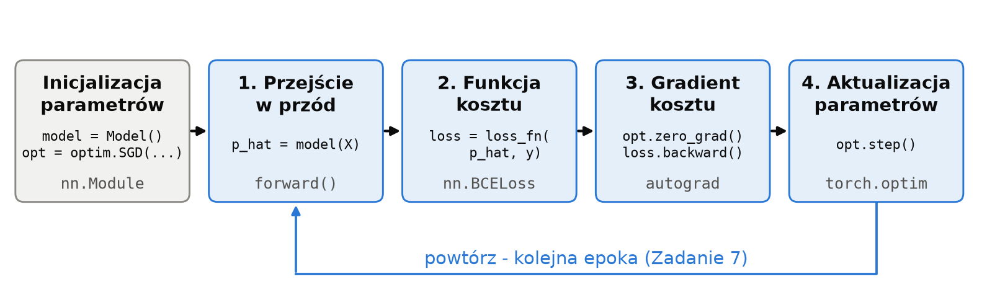

# Notatki: Część II - PyTorch

Pełne wersje tekstów z `lab_3_solution.ipynb` (stan na 2026-10-25, przed skróceniem).
Materiał prywatny prowadzącego - nie udostępniać studentom.

<!-- lab_3_solution.ipynb, komórka [33] -->

---
## Część II - PyTorch

Dotychczas do tworzenia pętli uczącej używaliśmy matematycznych definicji napisanych w Numpy. Mimo wszystko, większość tworzenia i szkolenia modeli jest raczej schematyczna, więc do tego typu operacji zwykle będziemy chcieli używać frameworka. Jednym z nich jest PyTorch - udostępniony przez zespół Facebook AI Research (FAIR), jego publiczna wersja pojawiła się w 2017 roku. Powstał na bazie wcześniejszych prac nad narzędziami do obliczeń tensorowych i uczenia głębokiego.

PyTorch to w gruncie rzeczy NumPy + GPU + [automatyczne różniczkowanie (Autograd)](https://docs.pytorch.org/tutorials/beginner/basics/autogradqs_tutorial.html). Właśnie automatyczne różniczkowanie pozwoli nam ograniczyć pisanie kodu związanego z poprawną implementacją gradient descent.

Najważniejsze moduły:
- `torch` - tensory i podstawowe funkcje, np. `Tensor`, `from_numpy()`,
- `torch.nn` - klocki sieci neuronowych, np. `Linear`, `Sigmoid`, `BCELoss`,
- `torch.optim` - optymalizatory, czyli warianty spadku wzdłuż gradientu.

Pętla ucząca ma te same kroki co w Części I:

| Krok | Część I (NumPy) | PyTorch |
|---|---|---|
| parametry + przejście w przód | `LogisticRegression.forward` | `nn.Module`, `nn.Linear`, `nn.Sigmoid`; wywołanie `model(X)` |
| funkcja kosztu | `bce` | `nn.BCELoss()` |
| gradient (backward pass) | `backward` | `loss.backward()` |
| aktualizacja (optymalizator) | `w - lr * grad_w` | `optimizer.step()` (+ `optimizer.zero_grad()`) |

### Tensory i autograd

---

<!-- lab_3_solution.ipynb, komórka [35] -->

API tensorów jest bardzo podobne do NumPy, ale na dwie rzeczy trzeba uważać:

- **Typ liczb** - NumPy domyślnie tworzy liczby typu `float64`, a warstwy w PyTorchu pracują na `float32`.
  Jeśli podasz modelowi tensor `float64`, dostaniesz błąd o niezgodnych typach. Dlatego dane z NumPy zamieniamy
  metodą `.float()` albo od razu tworzymy je przez `torch.tensor(..., dtype=torch.float32)`.

- **Output `shape`** - model zwraca jedną kolumnę wyników, czyli tensor o kształcie $(N, 1)$, a w Numpy etykiety mamy zwykle
  jako płaski wektor o kształcie $(N,)$. Funkcja kosztu wymaga, żeby predykcje i etykiety miały **ten sam** kształt,
  więc zamieniamy wektor etykiet w kolumnę metodą `.unsqueeze(1)` (dokłada wymiar o rozmiarze 1).
  W drugą stronę, z kolumny do płaskiego wektora, działa `.squeeze(1)`.

---

<!-- lab_3_solution.ipynb, komórka [37] -->

### Autograd - jak PyTorch liczy gradienty

W Części I gradient liczyliśmy sami: w przejściu w przód zapamiętywaliśmy wartości pośrednie (`z`, `p_hat`), a w funkcji
`backward` mnożyliśmy lokalne pochodne zgodnie z regułą łańcuchową. **Autograd** (automatyczne różniczkowanie) robi
dokładnie to samo, tylko automatycznie. Działa w czterech krokach:

1. **`requires_grad=True`** - oznaczamy tensory, po których chcemy liczyć pochodne. W modelach robi to za nas
   `nn.Module`: wszystkie parametry (wagi, biasy) mają tę flagę ustawioną od razu. Dane wejściowe i etykiety jej nie
   potrzebują, bo ich nie uczymy.

2. **Graf obliczeń** - każda operacja na oznaczonym tensorze (`*`, `+`, `**`, `@`, `sigmoid`, ...) tworzy nowy tensor,
   który pamięta, z czego powstał i jak policzyć swoją lokalną pochodną. Tę informację widać w atrybucie `grad_fn`.
   Graf powstaje „w locie”, podczas zwykłego wykonywania kodu.

3. **`.backward()`** - wywołujemy na wyniku, który jest jedną liczbą (zwykle na koszcie). PyTorch wykonuje backward pass:
   przechodzi graf od końca i mnoży lokalne pochodne (propagacja wsteczna), tak jak nasza funkcja `backward`. Pochodne są liczone ze wzorów analitycznych,
   więc są dokładne, a nie przybliżone jak w `df`.

4. **`.grad`** - wynik trafia do atrybutu `.grad` każdego tensora z `requires_grad=True`.

Zachęcam do zapoznania się z tym, jak sam Autograd funkcjonuje i co dzieje się pod spodem: [A Gentle Introduction to torch.autograd](https://docs.pytorch.org/tutorials/beginner/blitz/autograd_tutorial.html), [Autograd mechanics](https://docs.pytorch.org/docs/stable/notes/autograd.html), [automatyczne różniczkowanie na Wikipedii](https://en.wikipedia.org/wiki/Automatic_differentiation) oraz kurs [micrograd](https://www.youtube.com/watch?v=VMj-3S1tku0) Andreja Karpathy'ego, który przedstawia uproszczoną implementację tego narzędzia.

Sprawdźmy, jak Autograd działa na funkcji $f(x) = 3x^2 - 4x + 5$ z Zadania 1:

---

<!-- lab_3_solution.ipynb, komórka [39] -->

Ważne: PyTorch nie nadpisuje gradientu, tylko **dodaje** nowy do tego, który już jest w `.grad` (akumuluje go).

Bywa to przydatne, ale w zwykłej pętli uczącej oznacza, że przed każdym `backward()` **trzeba gradienty wyzerować** -
inaczej w każdej epoce byłyby coraz większe. Metody kończące się na `_`, jak `.zero_()`, zmieniają tensor w miejscu.
W pętli uczącej zerujemy wszystkie parametry naraz przez `optimizer.zero_grad()`.

---

<!-- lab_3_solution.ipynb, komórka [41] -->

Śledzenie operacji w autogradzie kosztuje czas i pamięć, a nie zawsze jest potrzebne - np. przy liczeniu predykcji albo rysowaniu
wykresów. Są na to dwa sposoby:

- blok `with torch.no_grad():` - operacje wewnątrz nie są zapisywane w grafie,

- `.detach()` - zwraca ten sam tensor, ale „odcięty” od grafu; przydaje się np. przed zamianą na NumPy
  (`tensor.detach().numpy()`).

Jednoelementowy tensor zamieniamy na zwykłą liczbę Pythona metodą `.item()`.

---

<!-- lab_3_solution.ipynb, komórka [43] -->

### Modele w PyTorchu: `nn.Module`

Modele w PyTorchu to klasy dziedziczące po `nn.Module` - podobnie jak nasza klasa `LogisticRegression` z Zadania 2.
Po kolei, co w takiej klasie robią poszczególne metody:

| Metoda | Kto ją definiuje | Co robi |
|---|---|---|
| `__init__` | my | tworzy warstwy i zapisuje je jako atrybuty (`self.linear = nn.Linear(...)`). Zawsze zaczynamy od `super().__init__()`. Każdy atrybut, który jest `nn.Module` (np. warstwa) albo `nn.Parameter`, zostaje zarejestrowany, a jego parametry dostają `requires_grad=True`. |
| `forward(X)` | my | przejście w przód: z danych `X` liczy wyjście modelu. To jedyna metoda, którą musimy napisać. |
| `model(X)` | PyTorch | wywołuje `forward(X)` (plus mechanizmy wewnętrzne PyTorcha), dlatego nigdy nie wołamy `forward` wprost. |
| backward pass | autograd | **nie definiujemy** metody `backward` - autograd buduje ją sam z operacji wykonanych w `forward` i działa na tensorach. Wywołujemy `loss.backward()` na koszcie. |
| `parameters()` | PyTorch | zwraca wszystkie zarejestrowane parametry modelu; przekazujemy je optymalizatorowi. |
| `zero_grad()` | PyTorch | zeruje gradienty wszystkich parametrów (to samo robi `optimizer.zero_grad()`). |
| `train()`, `eval()` | PyTorch | przełączają tryb treningowy i ewaluacyjny (niektóre warstwy działają inaczej podczas treningu). |

Podstawowym blokiem operacji w Torchu jest [`nn.Linear(in_features, out_features)`](https://docs.pytorch.org/docs/stable/generated/torch.nn.Linear.html) - to nasze `X @ w + b`. Zobaczmy, jakie parametry rejestruje:

---

<!-- lab_3_solution.ipynb, komórka [45] -->

### Zadanie 6: Regresja logistyczna w PyTorchu

Napisz regresję logistyczną jako `nn.Module`: warstwa liniowa z `n_features` wejściami i jednym wyjściem (logitem),
a po niej sigmoida (`nn.Sigmoid`). Zwróć uwagę, że `nn.Linear` przechowuje wagi jako macierz
`(out_features, in_features)`, czyli `(1, 2)` dla naszych danych. Przykład podobnej klasy: [Build the Neural Network - Define the Class](https://docs.pytorch.org/tutorials/beginner/basics/buildmodel_tutorial.html#define-the-class),
a także [Learning PyTorch with Examples - Custom nn Modules](https://docs.pytorch.org/tutorials/beginner/pytorch_with_examples.html#pytorch-custom-nn-modules).

Uzupełnij `LogisticRegressionTorch`. Użyj dokładnie nazw atrybutów `self.linear` i `self.activation`.

---

<!-- lab_3_solution.ipynb, komórka [48] -->

Sprawdźmy, że model w PyTorchu liczy te same gradienty co nasza implementacja w NumPy. Kopiujemy parametry z modelu NumPy do modelu PyTorcha i porównujemy
gradient z `loss.backward()` z Twoją funkcją `backward`.

---

<!-- lab_3_solution.ipynb, komórka [50] -->

### Optymalizatory

**Optymalizator** wykonuje krok aktualizacji parametrów - krok 4 pętli uczącej. W Części I robiliśmy to ręcznie z użyciem Gradient Descent:

$$
\theta \leftarrow \theta - \eta \, \nabla_\theta L
$$

W PyTorchu optymalizator dostaje przy tworzeniu listę parametrów modelu (`model.parameters()`) i stałą uczącą, a potem:

- `optimizer.zero_grad()` zeruje gradienty wszystkich tych parametrów,

- `optimizer.step()` aktualizuje parametry na podstawie gradientów, które `loss.backward()` zapisał w `.grad`.

**Ile danych na jeden krok?** Dotychczas liczyliśmy gradient na **całym** zbiorze danych, więc jeden krok to jedna
epoka. To jest **spadek wzdłuż gradientu (gradient descent, GD)**, nazywany też *full batch GD*. Dla dużych zbiorów
jest to często niewykonalne - cały zbiór nie mieści się w pamięci, a jeden krok trwa bardzo długo. Dlatego wymyślono:
- **stochastyczny spadek wzdłuż gradientu (stochastic gradient descent, SGD)** - gradient liczymy na jednym
  losowym przykładzie i od razu aktualizujemy parametry. To dość grube przybliżenie gradientu, ale pozwala robić
  szybko dużo małych kroków;
- **minibatch gradient descent** - kompromis używany w praktyce: gradient liczymy na losowej **paczce (batch)**
  $B$ przykładów, np. 32, 64 czy 128:

$$
L_B = \frac{1}{|B|} \sum_{i \in B} \ell_i
$$

$$
\theta \leftarrow \theta - \eta \, \nabla_\theta L_B
$$

Jedna epoka to wtedy wiele kroków - po jednym na każdą paczkę. Rzadko wspominanym, a ważnym faktem jest to, że
losowość paczek sama w sobie działa jak [regularyzacja](https://arxiv.org/abs/2101.12176), więc wielkość paczki
(`batch_size`) to także hiperparametr. W PyTorchu paczki tworzy się klasą `DataLoader` - poznasz ją w dalszej części
laboratorium. Uwaga na nazewnictwo: `optim.SGD` po prostu wykonuje krok w przeciwną stronę niż gradient, który mu
policzymy - jeśli liczymy go na całym zbiorze (tak jak tutaj), to jest to zwykły GD.

**Sprytniejsze kroki.** Zwykły krok zależy tylko od bieżącego gradientu. Popularne ulepszenia:
- **momentum** (`optim.SGD(..., momentum=0.9)`) - krok uwzględnia też kierunek poprzednich kroków, jak kula
  tocząca się z górki. Pomaga przejść przez płaskie fragmenty funkcji kosztu i tłumi oscylacje;
- **[Adam](https://arxiv.org/abs/1412.6980)** (`optim.Adam`) - łączy momentum z osobną, automatycznie dobieraną
  wielkością kroku dla każdego parametru. Uczy szybko i daje dobre wyniki nawet przy niekoniecznie idealnie dobranej
  stałej uczącej. W PyTorchu najlepiej korzystać z jego wersji `AdamW`, która poprawnie łączy go z regularyzacją L2.
  Jest to zasadniczo domyślny wybór przy treningu współczesnych sieci neuronowych.

**Zmiana stałej uczącej w trakcie treningu.** Im większa stała ucząca, tym większe kroki - uczymy szybciej, ale
możemy „przeskakiwać” minimum. Często zaczyna się więc od większej stałej uczącej i zmniejsza ją w trakcie treningu.
Nazywa się to **learning rate scheduling**; w PyTorchu służą do tego klasy z `torch.optim.lr_scheduler`.

| Optymalizator | PyTorch | Typowa stała ucząca |
|---|---|---|
| (minibatch) SGD | `optim.SGD(model.parameters(), lr=0.1)` | $10^{-2}$ - $10^{-1}$ |
| SGD z momentum | `optim.SGD(model.parameters(), lr=0.1, momentum=0.9)` | $10^{-2}$ - $10^{-1}$ |
| Adam / AdamW | `optim.AdamW(model.parameters(), lr=1e-3)` | $10^{-4}$ - $10^{-2}$ |

---

<!-- lab_3_solution.ipynb, komórka [51] -->

### Zadanie 7: Pętla ucząca w PyTorchu

Napisz pętlę uczącą w PyTorchu z optymalizatorem przekazanym jako argument. Do historii zapisuj
`loss.item()` (zwykła liczba) - sam tensor `loss` trzymałby w pamięci cały graf obliczeń.
Przykład podobnej pętli: [Optimizing Model Parameters - Full Implementation](https://docs.pytorch.org/tutorials/beginner/basics/optimization_tutorial.html#full-implementation)
oraz [Learning PyTorch with Examples - PyTorch: optim](https://docs.pytorch.org/tutorials/beginner/pytorch_with_examples.html#pytorch-optim);
dokumentacja: [`nn.BCELoss`](https://docs.pytorch.org/docs/stable/generated/torch.nn.BCELoss.html),
[`torch.optim`](https://docs.pytorch.org/docs/stable/optim.html).

Uzupełnij `train_torch`. Optymalizator jest argumentem, więc tej samej funkcji użyjemy później z innym optymalizatorem.

---

<!-- lab_3_solution.ipynb, komórka [54] -->

Przy predykcji przełączamy model w tryb ewaluacji (`model.eval()`) i wyłączamy liczenie gradientów
(`torch.no_grad()`), co oszczędza czas i pamięć. 

Przygotowaliśmy poniżej funkcję `torch_proba`, która to robi i zamienia output PyTorcha
na NumPy, który przyjmuje nasz `plot_decision_boundary` i `plot_training`.

Trenujemy regresję logistyczną w PyTorchu na danych z Części I - wynik jest taki sam jak dla Twojej implementacji
w NumPy (krzywe różnią się tylko na starcie, bo modele zaczynają z innych losowych parametrów).

---

<!-- lab_3_solution.ipynb, komórka [56] -->

### Zbiór make_moons

[`make_moons`](https://scikit-learn.org/stable/modules/generated/sklearn.datasets.make_moons.html) generuje dwa
przeplatające się półkola. Trenujemy na nim tę samą regresję logistyczną (krzyżyki to błędne predykcje).

---

<!-- lab_3_solution.ipynb, komórka [58] -->

**Koszt przestaje maleć**, a granica decyzyjna regresji logistycznej to zawsze prosta - dłuższy trening ani
inna stała ucząca tego nie zmienią. Potrzebujemy modelu o większym capacity, który będzie w stanie nauczyć się nieliniowych zależności. 

Nieliniową granicę decyzyjną moglibyśmy uzyskać, definiując model wykorzystujący np. kombinacje kwadratowe cech (więcej o tym na PUMach). Zamiast ręcznie projektować takie cechy, wykorzystamy jednak sieć neuronową, która potrafi uczyć się złożonych, nieliniowych zależności bez konieczności jawnego definiowania ich przez nas.

---
