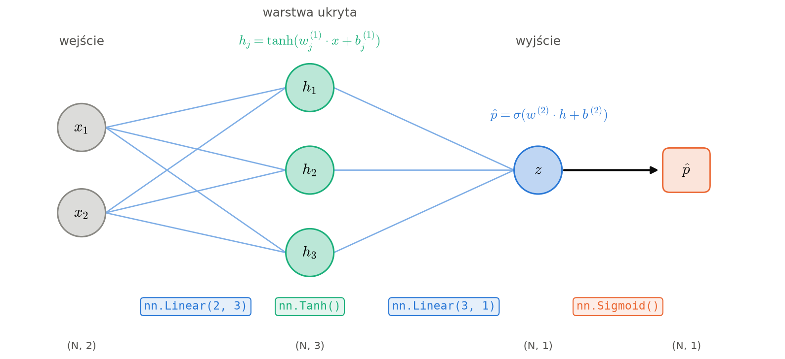

# Notatki: Część III - sieć MLP

Pełne wersje tekstów z `lab_3_solution.ipynb` (stan na 2026-10-25, przed skróceniem).
Materiał prywatny prowadzącego - nie udostępniać studentom.

<!-- lab_3_solution.ipynb, komórka [59] -->

---
## Część III - Sieć neuronowa MLP

Regresja logistyczna wyznacza liniową granicę decyzyjną w przestrzeni wejściowej, co ogranicza jej możliwości w przypadku bardziej złożonych zależności. Sieć neuronowa pozwala nam rozszerzyć przestrzeń rozwiązań - jest to możliwe dzięki warstwom ukrytym i nieliniowym funkcjom aktywacji, które przekształcają dane wejściowe w nowe reprezentacje, lepiej dopasowane do rozwiązywanego problemu.

Podstawowym elementem sieci neuronowej jest **neuron**: iloczyn skalarny wag z wejściem, bias i **funkcja
aktywacji (activation function)**. Nasza regresja logistyczna z Części I to dokładnie jeden neuron z aktywacją
sigmoidalną.

Odpowiednio skonstruowane sieci mogą pełnić funkcję uniwersalnych aproksymatorów. Oznacza to, że przy odpowiedniej liczbie neuronów i właściwie dobranych funkcjach aktywacji mogą z dowolną dokładnością przybliżać funkcje ciągłe na ograniczonych obszarach. W praktyce daje nam to dużą elastyczność w modelowaniu skomplikowanych zależności, choć samo istnienie takiej możliwości nie gwarantuje, że trening zawsze znajdzie dobre rozwiązanie.

W naszym zadaniu wykorzystamy architekturę nazwaną **MultiLayer Perceptron (MLP)** - sieć składającą się z kolejnych warstw neuronów.

**Warstwa ukryta (hidden layer)** to każda warstwa sieci leżąca między wejściem a wyjściem. Nazywamy ją „ukrytą”, bo jej wartości nie występują ani w danych wejściowych, ani w etykietach - nie mówimy sieci, co mają oznaczać. Sieć sama ustala je w trakcie treningu tak, żeby ułatwiały zadanie warstwie wyjściowej.

Nasza sieć ma **warstwę ukrytą** z 3 neuronami $\tanh$: każdy patrzy na wejście $x$ i zwraca jedną liczbę $h_j$. Wektor $h$ to
**ukryta reprezentacja (hidden representation)** - nowe cechy, których sieć uczy się sama. Warstwa wyjściowa to
zwykła regresja logistyczna, tyle że na cechach $h$ zamiast $x$.

Zapisana wzorami nasza sieć to dwie warstwy. Warstwa ukryta (macierz wag $W_1$ o kształcie $2 \times 3$):

$$
h = \tanh(x W_1 + b_1)
$$

i warstwa wyjściowa (macierz wag $W_2$ o kształcie $3 \times 1$):

$$
\hat p = \sigma(h W_2 + b_2)
$$

**Dlaczego aktywacja w warstwie ukrytej musi być nieliniowa?** Usuńmy $\tanh$ i zobaczmy, co zostanie z logitu
na wyjściu. Warstwa ukryta byłaby wtedy tylko przekształceniem liniowym:

$$
h = x W_1 + b_1
$$

Podstawiamy to do warstwy wyjściowej:

$$
z = h W_2 + b_2 = (x W_1 + b_1) W_2 + b_2
$$

i wymnażamy nawiasy:

$$
z = x \, (W_1 W_2) + (b_1 W_2 + b_2)
$$

Iloczyn $W_1 W_2$ to po prostu jedna macierz wag, a $b_1 W_2 + b_2$ - jeden wektor biasów. Dwie warstwy liniowe
dają więc znów **jedną** warstwę liniową, czyli zwykłą regresję logistyczną z granicą w postaci prostej - niezależnie
od liczby neuronów i warstw. Dopiero nieliniowa aktywacja pozwala sieci zginać granicę decyzyjną.

Warstwy łączymy
[`nn.Sequential`](https://docs.pytorch.org/docs/stable/generated/torch.nn.Sequential.html) (nie zwykłą listą
Pythona - jej parametry nie trafiłyby do `model.parameters()`, szczegóły w dokumentacji).

### Zadanie 8: Sieć MLP

Uzupełnij `MoonMLP`: w `self.layers` utwórz `nn.Sequential` z warstwami jak na schemacie, a w `forward` wywołaj go.
Przykład użycia `nn.Sequential`: [Build the Neural Network - nn.Sequential](https://docs.pytorch.org/tutorials/beginner/basics/buildmodel_tutorial.html#nn-sequential).
Trenujemy Twoją funkcją `train_torch`, ale z optymalizatorem **Adam** (patrz opis optymalizatorów przy Zadaniu 7).

---

<!-- lab_3_solution.ipynb, komórka [63] -->

Przez kilkaset epok koszt MLP stoi na poziomie regresji logistycznej (sieć zachowuje się jak model liniowy), a potem
gwałtownie spada, gdy sieć „odkrywa”, jak zgiąć granicę. Takie **plateau** są typowe przy uczeniu sieci.
Dokładność liczymy tu na zbiorze treningowym - w praktyce ocenia się model na osobnym zbiorze testowym.

Na plateau dobrze widać różnicę między optymalizatorami. Poniżej trenujemy tę samą sieć, z tego samego startu,
zwykłym SGD, SGD z momentum i Adamem.

---

<!-- lab_3_solution.ipynb, komórka [65] -->

Zwykłe SGD utyka na plateau i przez 1000 epok nie wychodzi poza wynik regresji logistycznej. SGD z momentum najszybciej
schodzi na plateau, ale zaczyna z niego wychodzić dopiero pod koniec treningu. Adam wychodzi z plateau najwcześniej
i jako jedyny osiąga 100% dokładności.

Zajrzyjmy teraz do środka sieci. Po lewej proste, na których neurony ukryte zmieniają znak - z tych „cięć”
sieć składa granicę. Po prawej punkty w przestrzeni ukrytej $h$: tu klasy rozdziela już **płaszczyzna** ostatniej
warstwy.

---

<!-- lab_3_solution.ipynb, komórka [67] -->

Na koniec porównajmy kilka architektur: sieci z 1, 2 i 3 neuronami ukrytymi oraz sieć z 8 neuronami bez
nieliniowości (`nn.Identity()` zamiast `Tanh`).

---
